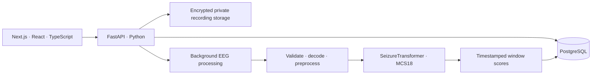

# AI-vEEG platform (based on EEG Viewer / MDS01)

### EEG signal review, from recording intake to inspectable model evidence.

A full-stack application for exploring EEG waveforms, reviewing flagged intervals, and keeping source recordings accessible through an authenticated research workspace.

This build adds the AI-vEEG modules to MDS01: **SeizureTransformer** (FYP-MCS18) is the EEG seizure model, and **facial emotion recognition** runs on uploaded videos alongside MDS01's VSViG video detection. See [the integration guide](docs/aiveeg-integration.md).


[Getting started](#getting-started) · [Architecture](docs/architecture.md) · [EEG processing](docs/backend.md) · [Documentation](docs/README.md)

## EEG review capabilities

| Capability | Implementation |
| --- | --- |
| Recording intake | EDF/EDF+, supported legacy Nicolet `.e`, and Nicolet `.data` with its matching `.head` sidecar. Unsupported or ambiguous layouts fail validation. |
| Waveform inspection | Owner-protected, bounded time-range reads from retained source recordings, with source timing and acquisition gaps preserved. |
| Model evidence | SeizureTransformer (MCS18) seizure scores shown as four-second windows; the legacy H5 model remains available. |
| Video analysis | VSViG seizure scores per window, plus a per-second facial expression timeline (not validated on seizure video). |
| Signal integrity | Source review remains separate from derived model input; physical units and historical relative-unit artifacts are distinguished. |
| Private case access | Session authentication, owner-filtered reads, encrypted recording storage, and private, no-store responses. |
| Reproducible local startup | Docker Compose services, database migrations, generated local secrets, and explicit real-model or synthetic-demo modes. |

## Engineering decisions

- **Read signals in bounded intervals.** The browser requests the section being reviewed instead of downloading an entire multi-hour recording.
- **Validate the model contract at startup.** The real H5 profile checks the reviewed artifact and contract and stops on a mismatch. It never silently substitutes synthetic scores.
- **Preserve source evidence.** Original recordings remain encrypted for owner-only review until case deletion; derived model input follows a separate preprocessing path.
- **Keep processing boundaries explicit.** Routes validate requests, services coordinate workflows, repositories handle database access, and format adapters decode recordings.
- **Handle gaps honestly.** Acquisition gaps stay visible and do not become fabricated signal samples or continuous inference windows.

## Architecture



PostgreSQL holds application records and EEG scores. Recording bytes live in separate private storage protected with AES-256-GCM. Processing temporarily decrypts the required inputs and cleans up plaintext intermediates. Background processing runs inside the API process; a durable distributed queue is outside the current local deployment.

| Area | Location |
| --- | --- |
| Browser interface and waveform review | [`frontend/src/`](frontend/src/) |
| HTTP routes and authentication | [`backend/app/api/`](backend/app/api/) |
| Processing and storage workflows | [`backend/app/services/`](backend/app/services/) |
| Recording format adapters | [`backend/app/eeg/`](backend/app/eeg/) |
| Model integration | [`backend/app/ml/`](backend/app/ml/) |
| Schema migrations | [`backend/migrations/`](backend/migrations/) |
| Setup and launchers | [`scripts/`](scripts/) |

## Getting started

### Prerequisites

- Git and Node.js **22 or newer**
- Docker Desktop running with Linux containers
- Internet access for the first Docker build and pinned external asset initialization

### Explore the workflow with synthetic scores

```sh
git clone https://github.com/4ffaad/eeg-viewer.git
cd eeg-viewer
node scripts/demo.mjs --development-stub
```

Open **[127.0.0.1:3000](http://127.0.0.1:3000)** and create a local account. The API reference is available at **[127.0.0.1:8000/docs](http://127.0.0.1:8000/docs)**.

The launcher generates ignored local configuration and encryption keys, starts Docker services, applies migrations, waits for the API, and starts the frontend. The first build takes longer. Synthetic EEG scores demonstrate the application workflow; they do not come from the H5 model. See the [synthetic recording instructions](docs/setup.md#use-a-synthetic-patient-folder-demo) for a walkthrough without patient data.

### Run with SeizureTransformer (default)

Get the SeizureTransformer weights from the MCS18 team and place them at:

```text
backend/model/official_seizure_transformer_model.pth
```

Then run:

```sh
node scripts/demo.mjs
```

SeizureTransformer reads the 19 single 10-20 electrodes (EDF with referential channels, Nicolet `.data`, or legacy Nicolet `.e`). Recordings that contain only bipolar pairs cannot be scored by it. Scores are uncalibrated research outputs. Details: [integration guide](docs/aiveeg-integration.md).

### Run the legacy H5 profile

Obtain the exact reviewed assets through an authorized project handover and place them at:

```text
backend/model/best_seizure_model.h5
backend/model/model-contract.json
```

Then run:

```sh
node scripts/demo.mjs --research-h5
```

Model files are intentionally excluded from Git. Startup fails if the artifact or contract is missing or mismatched. The input contract uses **256 Hz**, **18 configured bipolar channels**, and **four-second windows with a two-second stride**. Current scores are uncalibrated research outputs; they should not be presented as seizure probabilities or clinical confidence.

### Configuration and shutdown

The launcher reads `.env.example` and creates private local configuration. Keep `.env`, encryption keys, recordings, model assets, and generated patient reports outside Git. Preserve the storage key while encrypted recordings exist: replacing or losing it can make those recordings unreadable.

Stop the frontend with **Ctrl-C**, then stop backend services while retaining data:

```sh
docker compose down
```

`docker compose down -v` also deletes persistent database records, encrypted recordings, and downloaded model assets. Use it only for an intentional local reset.

## Development and verification

The repository includes backend `unittest` coverage, launcher checks, and Playwright browser suites. Synthetic and mocked checks validate application behavior; they do not establish clinical performance. See [setup and verification commands](docs/setup.md#checks) for each runtime and suite.

- [Backend implementation guide](docs/backend.md)
- [Frontend implementation guide](docs/frontend.md)
- [Architecture and security boundaries](docs/architecture.md)
- [EEG review and inference walkthrough](docs/inference-walkthrough.md)
- [Complete documentation index](docs/README.md)

The wider repository also includes associated-video review and an independent experimental video-analysis workflow, documented separately in the [video runbook](docs/video-detection.md).

## Project status

This is a local research prototype. Use synthetic or institutionally approved data. Services bind to loopback; public hosting requires additional deployment engineering, HTTPS, identity management, key lifecycle management, and recovery planning. Current access is owner-only, with no shared clinician roles.

Model outputs support research review and do not diagnose seizures or recommend treatment.
