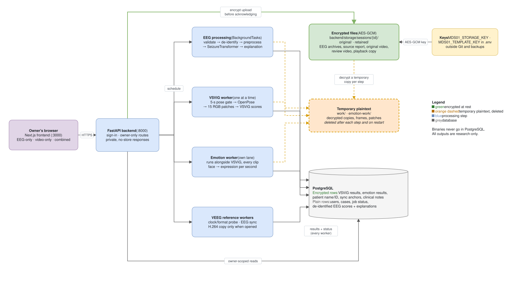
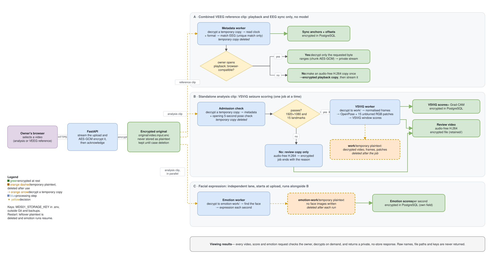

# Architecture diagrams

Editable Draw.io sources with static previews. Each diagram has a JSON graph
spec (the source of truth), the `.drawio` file built from it, an SVG preview,
and a high-resolution PNG copy of that preview for slides and reports.
None of them contain patient data, identifiers, paths to real files, or keys.

## System overview

How the browser, FastAPI, the background workers, private file storage, and
PostgreSQL fit together, and which data is encrypted at rest.



## Video pipeline and encryption

Every path a video takes after upload: combined VEEG reference clips (A),
standalone VSViG analysis (B), and the independent facial-expression lane (C),
which starts at upload and runs at the same time as B. Green is encrypted at
rest; orange dashed is temporary plaintext that is deleted after use.



The original video is encrypted once, during upload. Each worker decrypts its
own temporary copy (`work/` for VSViG, `emotion-work/` for facial expression)
and deletes it afterwards, so one worker's cleanup can never remove a file the
other is still reading.

## Editing

Edit the `.drawio` file in diagrams.net or the Draw.io desktop app, or change
the JSON spec and rebuild. Keep the cell IDs stable.

```sh
cd .agents/skills/drawio-mxgraph
for d in system-overview video-pipeline; do
  python3 scripts/drawio_tool.py build --offline \
    --spec ../../../docs/diagrams/$d.json --output ../../../docs/diagrams/$d.drawio
  python3 scripts/drawio_tool.py validate ../../../docs/diagrams/$d.drawio
done
cd ../../..
python3 docs/diagrams/render_preview.py docs/diagrams/system-overview.json docs/diagrams/video-pipeline.json
```

`render_preview.py` draws the SVG previews from the same JSON spec, including
explicit positions and edge waypoints (standard library only). The previews
use the spec's optional `zones` and edge `label_at` fields, which the Draw.io
build ignores.
